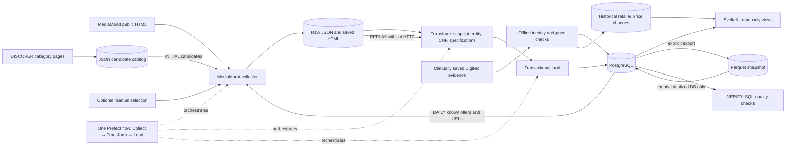

# Architecture v0.2 — local midterm system

The active system consists of a MediaMarkt adapter, a small manual Digitec proof of concept, retained Raw files, PostgreSQL, one Prefect flow, and a read-only SvelteKit frontend. Cloud, Terraform, GCS, and BigQuery belong to the final phase.

BRACK declined the team's data-access request without stating a reason. It is excluded from future retailer integration; this is a source-selection decision, not a claim about BRACK's technical systems or policies. Other retailers are only candidates until their product coverage, data access, and permitted request volume have been checked.

## Code and modes

`backend/flow.py` is the only pipeline CLI and Prefect entry point. `backend/retailers/mediamarkt/collector.py` handles bounded HTTP collection, robots.txt, listing discovery, and URL selection; `parser.py` extracts JSON-LD and embedded technical specifications. `backend/transform.py` validates Raw records, `backend/ingestion.py` loads them transactionally, and `backend/database.py` owns connections, migrations, and verification queries. `backend/seed.py` is an explicit offline snapshot utility, not a daily task. Tests and fixtures are in `backend/tests/`. There is no second pipeline or retailer microservice.

`backend/retailers/digitec/importer.py` accepts locally supplied files **without network access**. The midterm proof of concept is tied to the eight MediaMarkt products in the initial selection. A current Digitec offer requires a matching product page, product ID, retail seller and price, and an unambiguous EAN match. Seven chart-only JSON files are mapped in `data/catalog/digitec_manual_charts.json`; they add historical `validFrom` changes to `retailer_price_change`, but no current observation. A point without a price remains a gap. `price_history` contains only independently evidenced observations. Automated Digitec access is not configured.

- **DISCOVER:** Manual, links only. Parses category pages and pagination, saves normalized candidate URLs in `data/catalog/mediamarkt.json`; no product detail fetch or database import.
- **INITIAL:** Uses either `mediamarkt_initial.json` or unimported catalog candidates. Valid products create products, retailer offers, and first price observations.
- **DAILY:** Reads active, in-scope MediaMarkt offers and their URLs from PostgreSQL using `active_products()` and `select_daily()`. It does not discover new URLs or fetch category pages. It also checks locally supplied normalized Digitec inbox files, without Digitec HTTP access.
- **REPLAY:** Loads retained Raw files without HTTP and preserves their original observation times.
- **VERIFY:** Reads product, offer, observation, price-quality, and duplicate counts.
- **Seed export/import:** Explicit CLI operations, outside Prefect's daily schedule. Export writes a new Parquet bundle; import checks it and requires empty initialized tables. No HTTP endpoint or GitHub Action is involved.

Prefect schedules **DAILY only** at 03:00 Europe/Zurich. A fresh checkout starts paused through `.env.example`; the team's local `.env` enabled the deployment on 20 October. A sleeping host cannot guarantee a punctual run.

## Infrastructure and data model

`docker-compose.yaml` has four long-running services: `postgres`, `prefect_server`, `pipeline`, and `frontend`; `db_init` is a one-off schema job. They share `deng-project-network`. `postgres_data` and `prefect_data` are named persistent volumes. The pipeline bind-mounts `./data`; the frontend reads the catalog read-only. Local ports are 5432, 4200, and 3000. Database credentials stay on the SvelteKit server, not in the browser.

`backend.database.migrate()` applies `data/initialization.sql` and active `data/migrations/*.sql`, recording checksums. SQL under `data/migrations/archive/` is not applied. The core tables are `brand`, `category`, `retailer`, `product`, `retailer_product`, `price_history`, and GPU/RAM/SSD detail tables. `raw_import` records file provenance and import results. `retailer_product` retains the retailer SKU and URL; `price_history.collected_at` retains the real observation time. Raw hashes and the unique offer/timestamp constraint prevent duplicate imports. A genuine new day's fetch may produce a new observation even when the price is unchanged. Product identity requires evidence such as EAN, brand/MPN, or the existing retailer SKU; uncertain variants are not matched by name alone.

`backend/seed.py` exports eleven business tables as Parquet with SHA-256 hashes and row counts in a manifest. Import checks every file and refuses any nonempty target table, in one database transaction. The bundled snapshot helps a reviewer inspect the system immediately. Raw JSON and REPLAY remain the evidence of ingestion. The transformation normalizes RAM kit capacity and SSD TB to GB, checks positive CHF prices, and leaves unknown details empty. The `hardware_prices` view exposes prices, retailer, actual seller, category, time, and Raw provenance.

## Failure behavior and limits

The collector checks robots.txt, domain, SKU and redirects, HTML content type, a total request budget, and at least three seconds between requests. HTTP 401/403/429/503 stops further collection. Per-product network or validation failures are reported while other selected products continue. There are no automatic HTTP retries. The 20-second Requests timeout limits socket inactivity, not total wall time or host sleep. The scheduled run on 21 October began 50 minutes late while the Mac slept; another sleep interrupted one request for almost an hour. It still stored five successful observations and marked the overall flow Failed because three product attempts disconnected. See the [midterm audit](MIDTERM_AUDIT.md) and [run report](../data/catalog/runs/20261021T015016086824Z.json).

Successful Raw files survive partial failures and proceed through Transform/Load. Repeated Raw files are identified as duplicates. Reports separate newly collected observations from old Raw reprocessing. A technical partial result is deliberately marked **Failed** in Prefect so missing products remain visible. Failed offers keep their last successful observation and are eligible on a later permitted run. Three product attempts per category and 20 total HTTP requests do not cover the complete catalog in one day; the limits are not raised without agreed usage boundaries.

Compared with v0.1, the midterm scope was reduced to a verifiable local data pipeline. Compared with phase 3, the SvelteKit frontend is an optional fourth long-running service and catalog-based DISCOVER/INITIAL are connected. Historical designs and phase reports remain in [archive/](archive/); saved SQL, Prefect, and test evidence remains in [evidence/](evidence/). Exact commands are in the [runbook](RUN_COMMANDS.md).
