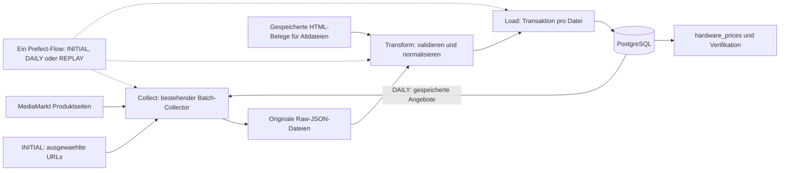

# Architektur v0.2 — Midterm MVP

Stand: Phase 3, 16.10.2026. Aktiver Umfang: MediaMarkt, Raw-Dateien, PostgreSQL und ein Prefect-Flow. Ausführungsnachweise und offene Punkte stehen in [PHASE3.md](PHASE3.md). Die finale README folgt in Phase 4.

INITIAL erfasst die ausgewählten URLs. DAILY bezieht vorhandene Angebote und Beobachtungszeiten aus PostgreSQL. REPLAY überspringt den HTTP-Abruf. Die drei Tasks laufen sequenziell. INITIAL/DAILY benutzen unverändert den bestehenden Collector mit robots-Prüfung, Request-Budget, mindestens drei Sekunden Abstand und Abbruch bei Sperren. Ein gemeldeter Abruffehler erlaubt das Laden bereits vorhandener Dateien, lässt den Gesamtlauf aber scheitern. Abgelehnte Einzeldateien bleiben sichtbar im Importbericht; akzeptierte Dateien werden trotzdem geladen. Null akzeptierte Dateien oder eine leere Datenbank gelten nicht als erfolgreicher Gesamtlauf.

Compose: `postgres`, `prefect_server`, `pipeline`. PostgreSQL und Prefect besitzen getrennte persistente Volumes. Alle Services verwenden dasselbe interne Netzwerk. Der Runner bedient den Zeitplan und kann mit demselben Image manuell gestartet werden. Prefect verwaltet seine Metadaten lokal in SQLite; die fachlichen Daten liegen in PostgreSQL. Linux-Container werden für die native Architektur gebaut, auf dem geprüften Mac ARM64. Windows muss Linux-Container verwenden; dessen unabhängiger Nachweis ist Phase 3.

Die neun ursprünglichen Fachtabellen bleiben erhalten: brand, category, retailer, product, retailer_product, price_history und drei Detailtabellen. Hinzu kommen nur `schema_migration` (angewandte SQL-Versionen) und `raw_import` (Datei-Hash, Pfad, HTML-Beleg, Status, Ablehnungsgrund). Keine Attribut-Herkunftstabellen, Matching-Review-Tabellen oder Digitec-Prioritätsmodelle im aktiven Schema.

`price_history.collected_at` ist weiterhin der ursprüngliche Beobachtungszeitpunkt; `ingested_at` ist der Ladezeitpunkt. Die bestehende Unique-Constraint auf Händlerangebot + Beobachtungszeitpunkt verhindert doppelte Beobachtungen. Der Datei-Hash verhindert erneutes Laden identischer Dateien. Eine neue tatsächliche Beobachtung darf denselben Preis enthalten. Ein Widerspruch zum bereits gespeicherten Ereignis wird abgelehnt, nicht überschrieben.

Produktzuordnung: gültige normalisierte GTIN, dann Hersteller + MPN; vorhandene Listing-Zuordnung muss dazu passen. Widersprüche werden abgelehnt. Ohne GTIN/MPN wird ein eigenes Produkt für die SKU angelegt, ohne Namens-Matching. Es gibt keine automatische Zusammenführung unterschiedlicher Varianten. Technische Werte werden nur ergänzt, bestehende widersprechende Werte nicht ersetzt.

Sinnvolle Transformation: Hersteller aus belegten technischen HTML-Angaben, SSD TB→GB und RAM-Kitkapazität über den vorhandenen Parser; geprüfte GTIN→14 Stellen, MPN-Normalisierung und Decimal-CHF-Preise im Import. `hardware_prices` zeigt Produkt, Kategorie, Plattform, tatsächlichen Verkäufer, Preis, Zeit und Rohdatei. CHF/GB erlaubt einen kapazitätsbezogenen SSD-Vergleich, ist allein aber kein Mass für die Gesamtleistung.

Gegenüber v0.1: Cloud, Frontend und vier Händler sind für den Midterm zurückgestellt; stattdessen besteht ein tatsächlich lokaler Datenfluss. Gegenüber dem umfangreichen Phase-1-Entwurf: drei statt 14 Compose-Services, ein Flow mit drei Tasks, kein Mastering und keine Review-Engine. Der alte Entwurf liegt unter `docs/archive/ARCHITECTURE_PHASE1.md`, die damalige Pipeline unter `docs/archive/phase1-code.tar.gz` und ihre Migration ausserhalb des aktiven Migrationsverzeichnisses unter `data/migrations/archive/`.

Grenzen: nur erstes JSON-LD-Angebot; keine vollständige Marketplace-Angebotsliste. Fehlender Verkäufer bleibt NULL, Buchmann bleibt Buchmann. Keine erfundene Historie. Alte HTML-Belege werden nur bei identischem Product-Payload verwendet; timestampierte Aufzeichnungen müssen zudem innerhalb von zwei Sekunden zur Originalbeobachtung liegen. Für die ältere Einzeldatei wird die vorhandene einzelne HTML-Aufzeichnung mit identischem Product-Payload verwendet; ihre separate Erfassungszeit ist nicht belegt. Originaldateien werden dabei nicht verändert.

Phase-3-Struktur: `backend/flow.py` ist der einzige Anwendungseinstieg. `database.py` enthält Verbindungen, Migrationen und lesende DB-Abfragen; `transform.py` Validierung/Normalisierung; `ingestion.py` Schreiben und Produktidentität. Der MediaMarkt-Adapter liegt unter `backend/retailers/mediamarkt/`. Neue Händler ergänzen später dort Beschaffung/Parsing und den expliziten Quellvertrag, ohne eigene HTTP-Services. Kein generisches Plugin-Framework. Das Datenbankschema wurde für den Cleanup nicht geändert.
