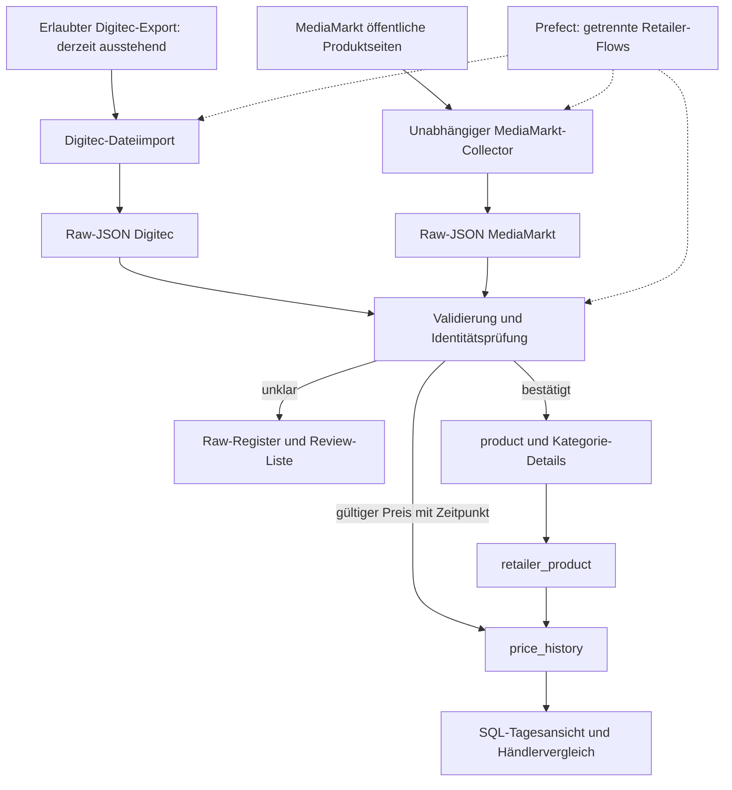

# DENG Architektur v0.2 – Analyse und Umsetzung

Stand: 15. Oktober 2026. Fokus: Digitec als bevorzugte Stammdatenquelle, MediaMarkt und ein nachvollziehbarer Händlervergleich. Die Freigabe für Digitec-Scraping ist angefragt, aber noch ausstehend. Deshalb führt dieses Projekt derzeit keine Digitec-HTTP-Abfragen aus.

## A. Analysierter Ausgangsstand

Untersucht wurde der Arbeitsstand auf Commit `a44ea653e5bd0b695c54cb2288bbd6bc9b40fb28`, einschliesslich der bereits vorhandenen lokalen Änderungen. `backend/orchestrator/dummy_flow.py` und `frontend/package-lock.json` waren schon vor dieser Arbeit geändert und wurden nicht überschrieben.

- Das bestehende SQL-Schema enthält alle neun gewünschten Kerntabellen und bereits sämtliche im Auftrag genannten grundlegenden GPU-, RAM- und SSD-Felder.
- Alle vier Ingestion-Programme sowie `seedDatabase/app.py` waren leer. `data/seed/data.parquet` ist eine leere Datei, kein historischer Datensatz.
- Digitec, BRACK und Interdiscount enthielten denselben Digitec-HTTP-Test. Die gespeicherten HTML-Dateien zeigen „Access denied“. Es gab keinen funktionsfähigen Digitec-Datenadapter.
- Die einzige Digitec-Raw-Datei enthält keine Produktstammdaten und keinen Preis. Sie ist keine gültige Preisbeobachtung.
- MediaMarkt besitzt einen Katalog mit 73 Einträgen: 5 akzeptiert, 1 ausgeschlossen, 67 Kandidaten. Sieben Raw-Dateien sind vorhanden. Eine ältere Einzelproduktdatei besitzt noch keine Scope-Validierung.
- Die 18 vorhandenen Offline-Scraper-Tests bestanden vor der Änderung. Sie prüfen Parsing und Katalogverhalten, nicht PostgreSQL-Ingestion oder echte historische Daten.
- Die Scraper-/Ingestion-Dockerfiles starteten nur `top`. Die BRACK-/Interdiscount-Services verwiesen in Compose auf MediaMarkt-Verzeichnisse. Raw-Mounts und DB-Anbindung dieser Jobs fehlten.
- Prefect war als Dummy mit einem erfundenen Demonstrationspreis angelegt. Der neue Produktionsflow verwendet diesen Dummy nicht. Das Frontend ist weiterhin ein Svelte-Demoprojekt.
- GCS, BigQuery und Terraform sind im ursprünglichen Pitch geplant, im untersuchten Checkout aber nicht implementiert. Sie sind nicht Voraussetzung des lokalen Midterm-MVP.

Konkrete Datenqualitätsbefunde: MediaMarkt-SKU `160229354` nennt im Originalangebot den Verkäufer „Buchmann“. Plattform und tatsächlicher Verkäufer dürfen deshalb nicht gleichgesetzt werden. Die ältere Datei zu SKU `2277751` enthält noch 2542 MHz Boost und „NVIDIA Blackwell“ als Generation; der aktuelle Parser liest aus demselben gespeicherten HTML 2512 MHz Standard-Boost und `RTX 50 Series`. Diese Altdatei wird ohne bestätigte Scope-Prüfung nicht stillschweigend übernommen.

## B. Bewertung der Digitec-Datenzugänge

Die Recherche bestätigt keine frei verfügbare, offiziell dokumentierte Schweizer Preisarchiv-API, mit der dieses Projekt zuverlässig bis 2022 zurückgehen könnte. Das ist ein Rechercheergebnis, kein Beweis, dass intern keine entsprechenden Daten existieren.

| Zugang | Nachweis / Zeitraum / Auflösung | Kosten und Rechte | Entscheidung |
|---|---|---|---|
| Offizieller Preisverlauf im Shop | Digitec Galaxus beschrieb 2021 Produktdiagramme für die letzten Monate. Daraus folgt weder ein bis heute abrufbares Archiv ab 2022 noch eine Exportgarantie. | Anzeige ist keine dokumentierte Datennutzungslizenz. | Kein automatisierter Zugriff solange Freigabe fehlt. [Offizielle Beschreibung](https://www.galaxus.ch/de/page/wir-setzen-auf-preistransparenz-21047) |
| Händler-/Lieferantenintegration | Dokumentierter Datenfluss ist primär Partner → Galaxus, einschliesslich Produktinformationen, Preisen und Beständen. Die Partnerdokumentation nennt FTP/Webservice und derzeit keine API-Verbindungen in diesem Integrationskontext. | Teilnahme/Vereinbarung erforderlich; kein publizierter Forschungsexportpreis. | Nicht mit einem lesbaren gesamten Shop-/Preisarchiv verwechseln. [Partnerdokumentation](https://confdg.atlassian.net/wiki/spaces/PHCM/pages/107305468545) |
| B2B/EDI/Punchout | Offiziell dokumentiert für Beschaffung, Warenkörbe und Bestelldokumente. | Individuelle Anbindung, keine belegte Archivlizenz. | Kein nachgewiesener Zugang zu historischen Verkaufspreisen. [B2B-Beschreibung](https://www.galaxus.ch/de/page/e-procurement-bei-digitec-galaxus-weil-kurz-mal-schnell-bestellen-im-b2b-leider-oft-nicht-reicht-42525) |
| Kooperation / Forschungsdatenexport | Zeitraum, Produkte, Historiensemantik, Datenlücken und Zeitauflösung individuell anzufragen. Zuordnung ideal über Digitec-ID, Hersteller+MPN und GTIN. | Kosten, Speicherung, HSLU-Abgabe und mögliche Veröffentlichung schriftlich klären. | Bevorzugter Weg; Anfrage des Teams läuft bereits. |
| Affiliate-Produktfeed | Ein offizielles Galaxus-Programm mit Produktdaten ist für Deutschland dokumentiert. Das belegt keinen Schweizer Feed und keine Preiszeitreihe. | Teilnahmebedingungen; CH-Abdeckung und Historie ungeklärt. | Keine Annahme einer Schweizer Preisquelle. [Galaxus Deutschland](https://www.galaxus.de/de/page/werden-sie-affiliate-partner-17259) |
| Toppreise / lizenzierter Vergleichsdatenexport | Produkt-/Händlerzuordnung und Historienabdeckung müssen bestätigt werden; ein Marktminimum ist kein Digitec-Verkaufspreis. | Die Nutzungsbedingungen verlangen für Reproduktion/Vervielfältigung eine schriftliche Genehmigung; Kosten eines Exports unbekannt. | Nur nach bestätigtem Datenvertrag. [Nutzungsbedingungen](https://www.toppreise.ch/impressum) |
| Dokumentierter Drittanbieter ReefAPI | Anbieter nennt Produktdaten, IDs und Preisverlauf; dokumentierter Rückblick bis 1095 Tage, somit am 15.10.2026 kein vollständiger Rückweg bis Anfang 2022. Diese Angaben wurden nicht durch einen Datenabruf verifiziert. | Anbieter nennt 1 Credit für Historie und 0.67–1.50 USD pro 1000 Credits. Eine Berechtigung zur Weiterverwendung der Shopdaten und eine mit euren Regeln vereinbare Erhebungsmethode sind damit nicht belegt. | Unter den Projektvorgaben vorerst nicht einsetzen. [Anbieterdokumentation](https://reefapi.com/docs/galaxus) |
| Öffentliche Datensätze | In der Recherche unter anderem auf Kaggle und Zenodo kein passender lizenzierter Digitec-GPU/RAM/SSD-Datensatz mit überprüfbarer Historie ab 2022 gefunden. | Unbekannt; keine belastbare Lizenz-/Abdeckungszusage. | Nicht als vorhandene Quelle einplanen. |

Der Importadapter ist absichtlich dateibasiert. Er nimmt ein dokumentiertes Austauschformat entgegen; sobald ein realer Export vorliegt, muss dessen tatsächliche Struktur überprüft und gegebenenfalls ein weiterer Mapper ergänzt werden. Es wird kein unbekanntes offizielles Exportformat vorgetäuscht. Keine Proxys, CAPTCHA-Umgehung, Browser-Fingerprints oder privaten Shop-Endpunkte werden verwendet.

## C. Master-Data-Strategie

`product` ist ein händlerunabhängiges Produkt einer konkreten Variante. Vorhandene MediaMarkt-Produkte können mit geprüften Identifikatoren bereits als `provisional` angelegt werden. Ein späterer konfliktfreier Digitec-Import ergänzt dieselbe Produkt-ID und setzt bei aktuellen Stammdaten `master_source=digitec` und `master_status=digitec_validated`. Ein reiner historischer Preisimport erklärt alte Stammdaten nicht automatisch zur aktuellen Wahrheit.

Digitec wird bevorzugt, aber Konflikte bei Hersteller, Kategorie, MPN oder bekannten Variantenmerkmalen blockieren die automatische Zusammenführung. Fehlende Werte bleiben NULL; ein NULL aus einem Folgeimport löscht keine vorhandene Spezifikation. Für übernommene Attribute wird die Raw-Datei als Quelle vermerkt. Herstellerangaben können später eine zusätzliche kontrollierte Quelle werden; sie werden nicht aus einem Modellnamen geraten.

Unterscheidungen: ASUS ist der Hersteller der ASUS-Karte; NVIDIA kann der GPU-Chiphersteller sein. MSRP ist nicht gleich durchgestrichener Händlerpreis. GPU-Architektur ist nicht Produktgeneration, PSU-Empfehlung nicht GPU-TDP, RAM-Kitkapazität nicht Modulkapazität und MHz nicht automatisch MT/s.

## D. Produkt-Matching

Reihenfolge: exakte normalisierte MPN innerhalb desselben Herstellers, dann geprüfte GTIN, dann vorhandene Listing-Zuordnung. Alle vorhandenen Identifikatoren müssen miteinander vereinbar sein. Zeigen MPN und GTIN auf verschiedene Produkte, wird nicht einfach die höher priorisierte Kennung gewählt.

- MPN-Normalisierung ist konservativ: Unicode-Normalisierung, Rand-Leerzeichen und Grossschreibung; Bindestriche, OC-/Kapazitäts-/Regionssuffixe bleiben erhalten.
- GTIN wird als String mit 8/12/13/14 Ziffern und Prüfziffer validiert, dann auf 14 Stellen mit führenden Nullen normalisiert. Eine gültige Prüfziffer allein bestätigt noch keine Identität. [GS1-Empfehlung](https://www.gs1.org/edi-xml/technical-user-guide/Item_Numbers)
- Pro Produkt sind mehrere validierte GTINs möglich. Jede GTIN gehört im kuratierten Bestand genau einem Produkt.
- Bekannte Variantenkonflikte, etwa GPU-VRAM oder RAM-Kitgrösse, führen zu `matching_review`.
- Namenskandidaten werden nie automatisch zusammengeführt. Der aktuelle MVP unterstützt einfache Kandidatenhinweise; ein ausgereiftes Fuzzy-Ranking und eine Review-Oberfläche sind Folgearbeit.
- Das Mapping eines bestehenden `retailer_product` wird nicht bei einem Folgeimport stillschweigend auf ein anderes Produkt umgehängt.

## E. Datenbank-Anpassungen

`data/initialization.sql` bleibt die nachvollziehbare Basis. `data/migrations/002_pipeline.sql` erweitert sie, der Runner verwaltet Prüfsummen in `schema_migration`. Ein erneuter Lauf wendet keine Migration doppelt an. Ein nachträglich verändertes bereits angewandtes Skript wird abgelehnt.

| Bereich | Ergänzung und Zweck |
|---|---|
| `product` | `mpn_normalized`, eindeutiges Hersteller+MPN-Paar, `master_source`, `master_status` |
| `product_gtin` | Mehrere GTINs pro Produkt; eindeutige bestätigte Zuordnung |
| `product_attribute_source` | Gewählter Attributwert mit Bezug zur Raw-Datei |
| `retailer_product` | SKU verpflichtend, Matchmethode und Herkunft der Zuordnung |
| `raw_record` | Dateipfad, SHA-256, Herkunft, Parser-Version, Status und Fehlergrund; Raw-Inhalt bleibt unabhängig im Dateisystem |
| `matching_review` | Unklare/ungültige Datensätze mit Grund und möglichen Produkt-IDs |
| `price_history` | Stabile Beobachtungskennung, `daily_scrape`/`historical_import`, `observed_at`, `price_date`, `collected_at`, `ingested_at`, Genauigkeit, Preissemantik, CHF, Raw-Referenz und Verkäufer |
| Schutz | Keine neuen NULL-/Nullpreisbeobachtungen, RAM-Kit-Konsistenz, Schutz vor versehentlichem Löschen verknüpfter Historie |
| Views | `daily_price_observation` und `digitec_mediamarkt_comparison` als funktionierende SQL-Transformation |

Bei neuen Tagesdaten ist `observed_at` der tatsächliche Abrufzeitpunkt. `price_date` wird dafür in Europe/Zurich bestimmt. Bei historischen Daten ist `price_date` das in der Quelle genannte Preisdatum; eine unbekannte Uhrzeit bleibt NULL und die Genauigkeit ist `day`. `collected_at` ist der Empfang/Abruf der Quelldaten, `ingested_at` der DB-Schreibzeitpunkt. Historische Punkte desselben Exports dürfen denselben `collected_at` besitzen.

Reruns werden auf zwei Ebenen abgefangen: identische Dateien über SHA-256, dieselbe fachliche Beobachtung über `observation_key`. Dieser Schlüssel enthält Quelle, Listing, Verkäufer, Beobachtungstyp und eine stabile Ereigniskennung. Bei Historie gehören Provider, Serie und Source-Beobachtungs-ID dazu. Preisänderungen unter derselben Ereigniskennung werden zur Prüfung gestellt. Ein gleicher Preis an einem tatsächlich neu beobachteten Folgetag erzeugt einen neuen Eintrag. Es gibt kein Forward-Fill in der Rohhistorie.

Ein gemeinsamer kleiner PostgreSQL-Advisory-Lock serialisiert die Identitätsentscheidung über alle Ingest-Prozesse; SQL-Constraints sichern die Eindeutigkeit zusätzlich. Für den kleinen Midterm-Katalog ist das bewusst einfach. Bei grösserem Volumen wären feinere Locks und eine skalierbare Queue zu prüfen. Transaktionen gelten pro Datei, Fehler einer Datei rollen nur deren fachliche Änderungen zurück.

Verkäuferinformationen liegen pro Beobachtung, damit ein Wechsel auf einer Plattform nicht rückwirkend die Historie verändert. Eine vollständige Marketplace-Angebotsverwaltung mit mehreren gleichzeitig erfassten Offer-IDs ist noch nicht umgesetzt. Der Collector nimmt weiterhin das erste JSON-LD-Angebot; unbekannte Verkäufer werden als unbekannt markiert und nicht für den strengen Händlervergleich verwendet.

## F. Raw-JSON-Vertrag

Eine JSON-Datei enthält eine Produkt-/Beobachtungseinheit. Neue MediaMarkt-Dateien bewahren sowohl unverändertes geparstes Product-JSON-LD als `raw_payload` als auch den vollständigen HTML-Text und dessen Hash. Digitec-Importe bewahren den unveränderten Exportdatensatz sowie das Eingabedokument. Die bestehenden Raw-Dateien werden nicht rückwirkend umgeschrieben.

Pfadkonvention: `data/raw/<retailer>/...json`. Bei MediaMarkt-Batches ist der Name SKU+Beobachtungstag; beim Digitec-Import ein deterministischer Hash. `data/import/digitec/` ist nur der Eingang für erlaubte Exporte, nicht die Datenbank.

| JSON-Bereich | Inhalt |
|---|---|
| `metadata` | Source, ID, URL, `collected_at`, Methode, Kategorie, Scope, Parser-/Schema-Version und Beobachtungstyp |
| `brand`, `product` | Hersteller, Titel, EAN/MPN, optionale allgemeine Stammdaten |
| `gpu_details` / `ram_details` / `ssd_details` | Vorhandene explizit belegte Schemafelder, sonst NULL |
| `retailer_product` | Source-SKU und URL |
| `price_history` | Preis, Währung, Referenzpreis, Verfügbarkeit; bei Historie tatsächliches Datum und Preissemantik |
| `seller` | Falls explizit bestätigt: Verkäufer-ID/-Name, `verified`, `is_retailer` |
| `raw_payload`, `source_document`, `technical_payload` | Originaldaten und Extraktionsbelege |
| `provenance` | Mapper-Version und bei Digitec Referenz zur erteilten Erlaubnis/Datenvereinbarung |

Ein damaliger Digitec-Austauschentwurf und Regeln stehen in [DIGITEC_IMPORT.md](DIGITEC_IMPORT.md). Beispielwerte werden nicht als Produktionspreise geladen. Eine neue Parser-Auswertung alter HTML-Dateien ist keine neue Preisbeobachtung; der einfache `saved_html`-Modus wird deshalb von der Ingestion nicht als Tageserhebung akzeptiert.

## G. Pipeline-Architektur

Raw-Erzeugung benötigt keine DB-Verbindung. Ingestion liest nur gespeicherte Daten. Ein Digitec-Fehler stoppt den MediaMarkt-Flow nicht. Wenn ein Collector fehlschlägt, können bereits gespeicherte Dateien trotzdem eingelesen werden. Bei 403/429/503 stoppt der bestehende MediaMarkt-Collector; der neue Flow wiederholt ihn nicht automatisch im Sekundentakt.

Alle aktiven Compose-Services verwenden `platform: linux/amd64`, Builds zusätzlich `build.platforms`. Damit ist die Containerplattform auf Windows und Mac gleich. Windows benötigt Docker Desktop im Linux-Container-Modus; Apple Silicon emuliert amd64, was Builds verlangsamen kann. Python übernimmt die Startlogik, nicht ein hostabhängiges Bash-Skript.

## H. Priorisierte nächsten Schritte

1. Jetzt: erlaubte vorhandene MediaMarkt-Raw-Daten ingestieren, Transaktionen/Reruns/SQL-Transformation demonstrieren und Prüfliste offenlegen.
2. Vor Midterm: Setup auf dem zweiten Rechner reproduzieren; echten Flow in Prefect, SQL-Nachweise und Fehlerbehandlung gemeinsam erklären.
3. Sobald Digitec antwortet: Bedingungen dokumentieren, realen Export/erlaubten Zugriff prüfen und Mapper anhand tatsächlicher Payloads ergänzen. Danach Stammdaten und aktuelle Preise importieren und Überschneidungen nachweisen.
4. Historie: nur belegte Daten mit bekannter Produkt-/Verkäuferzuordnung, Zeitraum, Zeitzone und Preissemantik aufnehmen. 2022 ist ein Beschaffungsziel, kein zugesicherter Datenbestand.
5. Danach: Review-Werkzeug, Aliasverwaltung, vollständige Marketplace-Offers, breitere Master-Data-Qualitätsprüfung und BRACK/Interdiscount. Cloud und Dashboard erst nach stabilem lokalem Ablauf.

Der echte Vergleich bleibt solange leer, bis dieselbe bestätigte Variante an demselben Tag bei beiden verifizierten Verkäufern beobachtet wurde. Leere Resultate sind hier korrekt und werden nicht mit Beispielpreisen gefüllt.
